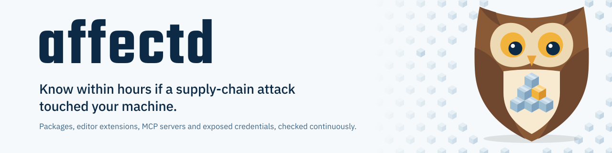

<picture>
  <source media="(prefers-color-scheme: dark)" srcset="docs/brand/banner/affectd-banner-dark.svg">
  
</picture>

# affectd

affectd tells developers when a supply-chain attack has reached their machine, and what to do about it.

It keeps an inventory of what you have installed: packages in every project, global tools and package caches, editor extensions and MCP servers. Every hour it checks that inventory against new malicious-package reports from [OpenSSF Malicious Packages](https://github.com/ossf/malicious-packages) and [OSV](https://osv.dev). When a report matches something on your machine, affectd tells you where it is, whether the attack left anything behind, which credentials it could have read, and the steps to take, in the right order.

Most malicious packages are reported hours or days after people install them. Install-time checks can't catch those. affectd re-checks what is already installed whenever new data arrives, so last week's install is caught by today's report.

> [!NOTE]
> affectd is in early development and has no release yet. The first version, a command-line tool for macOS and Linux, is planned for early 2027. Feedback on the design is welcome in [Discussions](https://github.com/affectd/affectd/discussions).

## Why

In September 2025 the Shai-Hulud worm compromised more than 500 npm packages and stole credentials from developer laptops and CI runners. In May 2026 a poisoned VS Code extension on one employee's laptop led to the theft of about 3,800 of GitHub's internal repositories.

After each attack, developers had to work out by hand whether they were affected, usually with a script written for that one attack. affectd answers the question for every attack, on every machine it runs on.

## What it checks

| Area | What affectd looks at |
| --- | --- |
| Packages | Lockfiles and installed packages in each project, global installs and package caches |
| Editor extensions | VS Code, Cursor, VSCodium and Windsurf |
| MCP servers | Servers configured for Claude, Cursor, VS Code, Windsurf, Codex and other AI tools |
| Attack traces | Files, startup items, workflows and repositories that known campaigns leave behind |
| Credentials | Where tokens and keys are stored, so it can tell you what to rotate. It records locations and never reads the values |

## How it works

affectd reads package manifests, extension folders and MCP configuration files with [OSV-SCALIBR](https://github.com/google/osv-scalibr). It parses files and never runs package managers or package code.

Threat data comes as a single file, built every hour by a public GitHub Actions workflow and signed with [Sigstore](https://www.sigstore.dev). affectd downloads it, checks the signature, and matches locally. Your inventory never leaves your machine, and affectd has no servers and no telemetry.

When a match comes from a known campaign, affectd also checks for that campaign's traces, such as a startup item or a rogue GitHub workflow. Each finding comes with ordered steps. The order matters: some attacks plant a process that wipes your home folder when it sees a stolen token revoked, so that process has to go before the token does.

Detection is exact matching against published data. An optional AI assistant can explain a finding in plain language, but it can't decide that something is safe or hide a finding.

## Planned usage

The command-line tool doesn't exist yet. This is the intended shape:

```sh
affectd scan            # check this machine now
affectd watch           # keep running and alert on new matches
affectd explain <id>    # what a finding means and what to do
```

## Data sources

affectd uses data from [OSV](https://osv.dev), [OpenSSF Malicious Packages](https://github.com/ossf/malicious-packages) and the [GitHub Advisory Database](https://github.com/github/advisory-database), each under its own licence and with attribution. affectd is not affiliated with or endorsed by the OpenSSF, Google or GitHub.

## Contributing

We'd like help, especially reports of attacks affectd misses or flags wrongly. Start with [CONTRIBUTING.md](CONTRIBUTING.md). Questions go in [Discussions](https://github.com/affectd/affectd/discussions).

The project's maintainers are listed in [MAINTAINERS.md](MAINTAINERS.md), and [GOVERNANCE.md](GOVERNANCE.md) explains how decisions are made. Everyone taking part follows our [Code of Conduct](CODE_OF_CONDUCT.md).

## Security

Please report security problems in affectd privately, as described in [SECURITY.md](SECURITY.md), not in a public issue.

## License

affectd is licensed under the [Apache License 2.0](LICENSE).
